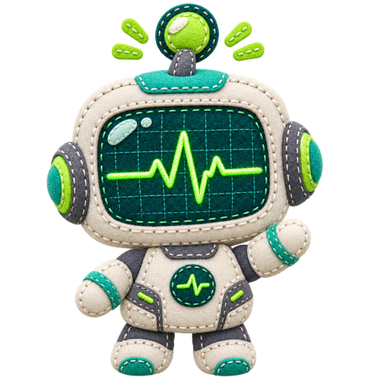
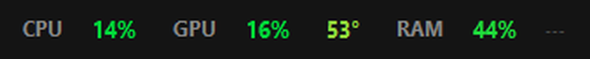

<div align="center">



# hwpill_gadget

**Un monitor de sistema flotante para Windows: eficiente, de código abierto y sin telemetría.**

CPU, GPU y RAM en tiempo real, en una pastilla pequeña que no estorba.


-0078D6?logo=windows&logoColor=white)




*Pequeño, sin bordes, siempre a la vista y sin molestar.*

</div>

---

## 🌿 Eficiente y de código abierto

- 🪶 **Eficiente de verdad.** Medido en una copia limpia del repositorio, durante 20 segundos y con CPU, GPU, RAM y VRAM activas: **0,6 % de un solo núcleo** (un 0,02 % del total en un equipo de 24 hilos) y **unos 63 MB de RAM**. El motivo: lee con `psutil` y NVML directamente, sin lanzar programas por detrás; los sensores van en un hilo aparte; y la interfaz solo cambia el texto de unas pocas etiquetas por segundo. Sin navegador embebido ni servicios: solo `tkinter`. *(Medido en Windows 11 con GPU NVIDIA; en otros equipos variará.)*
- 🔓 **Código abierto, licencia MIT.** Úsalo, cópialo, modifícalo y compártelo. Son unas 720 líneas de Python que se leen en una tarde: lo que ves en el repositorio es lo que se ejecuta.
- 🕵️ **Nada oculto.** Sin telemetría, sin cuentas y sin binarios dentro del repositorio.
- 🤝 **Contribuciones bienvenidas.** Si encuentras un fallo o tienes una idea, abre un *issue* o un *pull request*.

## ✨ Todo lo que hace

- ⚡ **Tiempo real:** se actualiza cada segundo.
- 🚦 **Colores de semáforo:** del verde al rojo según la carga (desde el 40 %) o la temperatura (de 40° a 85°).
- 🧩 **Métricas a la carta:** CPU, GPU, RAM, VRAM, potencia de CPU y GPU, reloj de CPU, red y disco. Solo se dibuja lo que activas.
- 📌 **Siempre encima de todo:** se mantiene sobre cualquier ventana, incluso sobre otras "siempre encima".
- 🔒 **Bloqueable:** lo dejas fijo para no moverlo sin querer. Hay un atajo, **Fijar**, que lo bloquea y lo pone siempre encima de una vez.
- 🖱️ **Se arrastra** con el ratón y se puede devolver a su esquina con un clic.
- 🪟 **Transparencia** ajustable (100 / 88 / 75 / 60 / 40 %).
- 💬 **Detalle al pasar el ratón:** RAM y VRAM usadas en GB.
- 🧠 **Lo recuerda todo:** posición, métricas, transparencia, bloqueo y "siempre encima".
- 🫥 **Discreto:** sin bordes y sin icono en la barra de tareas.
- 🛡️ **Tolerante a fallos:** si un sensor falla muestra `--` y sigue funcionando.
- 🎮 **GPU NVIDIA:** lectura por NVML y, si falla, por `nvidia-smi`.
- 🔌 **Sensores de CPU opcionales:** potencia y reloj, descargados con tu permiso y verificados por hash.
- 🚀 **Autoarranque:** con un doble clic arranca con Windows.
- 🌐 **Interfaz en español**, con un resumen en inglés más abajo.

## 🚀 Instalación rápida

> Probado en **Windows 11**. Debería funcionar en Windows 10, pero no lo he comprobado.

1. 🐍 Instala [Python](https://www.python.org/downloads/) 3.11 o superior. Marca la casilla *Add python.exe to PATH*.
2. 📥 Descarga el proyecto: botón verde **Code → Download ZIP**, o con git:
   ```
   git clone https://github.com/AngelmzDev/hwpill_gadget.git
   ```
3. 📦 En la carpeta del proyecto, instala las dependencias:
   ```
   pip install psutil nvidia-ml-py
   ```
4. ▶️ Ábrelo:
   ```
   pythonw gadget.py
   ```

Eso es todo. Aparece en la esquina inferior derecha de tu pantalla principal.

> 🎮 **GPU:** el uso, la temperatura y la VRAM de la GPU funcionan con tarjetas **NVIDIA**. Sin ella, esos campos muestran `--` y el resto funciona igual.

## 🎛️ Menú

Pulsa el botón `⋯` del final del panel (o haz clic derecho sobre él):

| | Opción | Qué hace |
|---|---|---|
| 🧩 | **Métricas** | Elige qué mostrar. Siempre queda al menos una. |
| 🪟 | **Transparencia** | 100 / 88 / 75 / 60 / 40 %. |
| 📌 | **Siempre encima de todo** | Lo mantiene sobre cualquier ventana. No cubre juegos en pantalla completa exclusiva. |
| 🔒 | **Bloquear posición** | Impide arrastrarlo por accidente. |
| 📍 | **Fijar** | Atajo: bloqueado y siempre encima, de una vez. |
| 🎯 | **Reiniciar posición** | Lo devuelve a la esquina por defecto. |
| 🔌 | **Instalar sensores de CPU** | Solo aparece si faltan. Ver la siguiente sección. |
| ❌ | **Cerrar** | Detiene los sensores y cierra. |

Tus ajustes se guardan en `config.json`, junto al programa, y no salen de tu equipo.

## 🔌 Potencia y reloj de CPU (opcional)

Estas dos métricas usan [LibreHardwareMonitor](https://github.com/LibreHardwareMonitor/LibreHardwareMonitor) y necesitan **ejecutar el gadget como administrador**.

- 📭 **Este repositorio no incluye ningún binario.**
- 🙋 Si el gadget se ejecuta como administrador y faltan las DLL, te pregunta **una sola vez** si quieres descargarlas. También puedes hacerlo desde el menú.
- 🔐 Se descargan de **nuget.org** (`LibreHardwareMonitorLib 0.9.6`, MPL-2.0, y `HidSharp 2.6.4`) y se comprueba el **SHA-256** del paquete y de cada DLL contra los valores fijados en `sensores.py`. Si algo no coincide, **no se instala nada**.
- ⚠️ Cargar DLL en un programa con permisos de administrador es una decisión de confianza: lee `sensores.py` (son unas 70 líneas) antes de aceptar.
- 🙅 Si prefieres no hacerlo, el resto del gadget funciona igual y esas dos métricas muestran `--`.

Para activarlas hace falta además `pip install pythonnet` (Python 3.13 o anterior).

## 🔁 Arrancar con Windows

Haz doble clic en `instalar_autostart.bat` (pide permiso de administrador). Crea una tarea programada llamada **hwpill_gadget** que lanza el gadget al iniciar sesión.

Para quitarla: `schtasks /Delete /TN "hwpill_gadget" /F`

## 🧠 Cómo funciona

| Dato | De dónde sale |
|---|---|
| 🧮 CPU % y RAM % | `psutil` |
| 🌐 Red y disco | `psutil` (velocidad entre dos lecturas) |
| 🎮 GPU %, temperatura, VRAM y vatios | NVML (`nvidia-ml-py`); si falla, `nvidia-smi` |
| ⚡ Potencia y reloj de CPU | LibreHardwareMonitor (opcional, necesita administrador) |

Los sensores se leen en un hilo aparte para que el panel no se congele. Si una fuente falla, muestra `--` y sigue. Los errores se anotan en `gadget.log`, junto al programa.

## 🔒 Privacidad y seguridad

- 🚫 Sin telemetría, sin cuentas y sin conexiones, salvo la descarga opcional de sensores que tú aceptas.
- 🏠 Tu configuración (`config.json`) y el registro (`gadget.log`) se quedan en tu carpeta.
- 🧾 Código corto y sin dependencias raras: `gadget.py` y `sensores.py`.

## ❓ Preguntas frecuentes

<details>
<summary>🙈 No veo el panel al abrirlo</summary>

Si cambiaste de monitores, puede haberse quedado fuera de la pantalla. Borra `config.json` y vuelve a abrirlo, o usa **Reiniciar posición** desde el menú.
</details>

<details>
<summary>🎮 La GPU sale como `--`</summary>

La lectura de GPU solo funciona con tarjetas NVIDIA y necesita `pip install nvidia-ml-py` (o tener `nvidia-smi` en el sistema).
</details>

<details>
<summary>🌡️ ¿Por qué no hay temperatura de CPU?</summary>

No se muestra a propósito. Sí puedes ver la **potencia y el reloj** de la CPU si instalas los sensores opcionales.
</details>

<details>
<summary>📌 "Siempre encima" no funciona en mi juego</summary>

Los juegos en **pantalla completa exclusiva** tapan cualquier ventana. Ponlo en modo ventana sin bordes y se verá encima.
</details>

<details>
<summary>🗑️ ¿Cómo lo desinstalo?</summary>

Menú `⋯` → **Cerrar**, quita la tarea programada con `schtasks /Delete /TN "hwpill_gadget" /F` y borra la carpeta.
</details>

## 🇬🇧 English

<details>
<summary>Click to expand</summary>

**hwpill_gadget** is a tiny always-on-top Windows panel that shows CPU, GPU and RAM usage (plus GPU temperature and VRAM) in real time. It is a single Python + tkinter file, has no telemetry and is MIT licensed.

**Quick start:** install Python 3.11+, run `pip install psutil nvidia-ml-py`, then `pythonw gadget.py`. Open the `⋯` menu to pick metrics, change transparency, lock the position or pin it above every window.

**Optional CPU power/clock sensors:** they use LibreHardwareMonitor and need to run as administrator. Nothing is bundled: the gadget asks once, and only if you accept it downloads two packages from nuget.org with pinned SHA-256 hashes (see `sensores.py`).

**Autostart:** double-click `instalar_autostart.bat` to create a scheduled task named `hwpill_gadget`.

Tested on Windows 11. GPU readings need an NVIDIA card.

</details>

## 📄 Licencia

MIT. Mira [`LICENSE`](LICENSE). Los avisos de componentes de terceros están en [`THIRD_PARTY_NOTICES.md`](THIRD_PARTY_NOTICES.md).

---

<div align="center">

Hecho con ☕ por [AngelmzDev](https://github.com/AngelmzDev) · ¿Te ha servido? Una ⭐ ayuda a que lo encuentre más gente.

</div>
